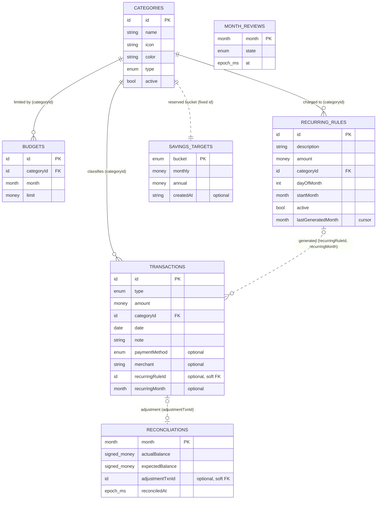

# Fiscal Focus — Database Design

**Version:** 1.0
**Updated:** 2026-11-05
**Inputs:** [PRD.md](./PRD.md) v1.1 (product scope, §6 financial baseline, §9 data requirements), [ARCHITECTURE.md](./ARCHITECTURE.md) v1.0 (§6 data flow, §8 on-device persistence, §9 security), current source in `artifacts/financial-clarity/src/`
**Status:** Target data model. Items marked **MVP-cleanup** or **Approved change** describe how existing storage must converge on this design. They are not authorized for implementation by this document alone (PRD §15, "Execution").

Labels used in this document:

| Label | Meaning |
|---|---|
| **Existing** | Present in current source today |
| **Approved change** | Owner-approved in the PRD; may not be implemented yet |
| **MVP-cleanup** | Required by ARCHITECTURE.md before release; not yet implemented |
| **Owner-approved** | Approved by the owner during the database design review on 2026-11-05; not yet recorded in the PRD |
| **Future** | Direction only; needs an ADR and owner approval |

---

## 1. Database Technology

### 1.1 Decision

| Aspect | Choice |
|---|---|
| Engine | Android WebView **`localStorage`**, private to the app sandbox |
| Model | Key-value store. Each key holds one JSON document. Each finance collection is a JSON array stored under one key |
| Access | Synchronous reads and writes, only through the storage layer (`src/lib/storage/`, ARCHITECTURE §4.1) |
| Atomicity | One key write is atomic. Multi-key writes use snapshot-and-rollback (§7.3) |
| Capacity | About 5 MB per origin, treated as a hard limit (ARCHITECTURE §8.1) |
| Encryption at rest | **None.** The app discloses this (PRD FR-12) |
| Namespace | Every key starts with `financial-clarity:`. This prefix is **frozen** and is not renamed for the Fiscal Focus brand (PRD FR-01) |

This document describes the store **as a logical relational model**: "tables", "columns", "primary keys", and "foreign keys". The rules are enforced by TypeScript type guards (one validator per entity) and domain-layer mutations, not by a database engine. Each logical table maps to exactly one storage key or key pattern.

### 1.2 Why not a different database

| Option | Decision | Reason |
|---|---|---|
| PostgreSQL or any server database | **Not used** | PRD §10: no finance backend or server database. The former `lib/db` scaffold was deleted on 2026-11-06 |
| SQLite (Capacitor plugin) | **Future** | Not needed at current data sizes. It would add a native dependency and a migration. See §11 for triggers |
| IndexedDB | Not used | Asynchronous writes weaken "saved means saved" (ARCHITECTURE §8.6). It offers no benefit at current data sizes |

### 1.3 Scope of data

There is **one local user per device dataset**. There are no accounts, no household members, no server identities, and no multi-device sync (PRD §2, §8). The schema therefore has **no user, tenant, or owner tables or columns**. Ownership comes from the device sandbox (§8).

---

## 2. Conventions and Logical Types

| Logical type | Stored as | Rule |
|---|---|---|
| `id` | JSON string | Opaque, non-empty, generated on the device. **Never reused or rewritten.** Seeded categories use fixed slug IDs, such as `groceries` or `savings-goal` |
| `money` | JSON number | Positive, finite **rupees** (INR). Direction comes from the transaction type, not the sign. Round **only** in the formatter. **No new monetary model** (PRD §6, D3) |
| `signed_money` | JSON number | Finite rupee value that may be negative. Used only for reconciliation balances |
| `date` | `"YYYY-MM-DD"` | Local calendar date. Must be a valid calendar date. Used for financial entries |
| `month` | `"YYYY-MM"` | Local calendar month. Boundaries come from one shared domain helper |
| `epoch_ms` | JSON number | UTC instant in milliseconds. Used for event timestamps in existing local keys |
| `iso_ts` | `"…Z"` string | ISO-8601 UTC instant. Used in the backup file envelope |
| `enum<…>` | JSON string | Must be one of the listed values |
| `bool` | JSON boolean | — |
| `int` | JSON number | Must be an integer |

General rules:

- A missing optional column is stored as an **absent key**, not as `null`. The only exceptions are columns marked as nullable below.
- Text fields are trimmed when saved. Validation failures keep the entered form values (PRD FR-02).
- An event timestamp keeps the representation already used by its key: `epoch_ms` locally and `iso_ts` in backups. Do not convert existing values.

---

## 3. Storage Key Catalogue

All key names live in **one module**, `src/lib/storage/keys.ts`. No other file contains key strings (ARCHITECTURE §8.2); a unit test enforces this. Moved there on 2026-11-11 from `FinanceContext`, `backup.ts`, `security.ts`, `onboarding.ts`, `googleAuth.ts`, `month-end-review.ts`, and `BackupContext`.

| Logical table | Storage key | Shape | In Drive backup? |
|---|---|---|---|
| `transactions` | `financial-clarity:transactions` | Array | Yes |
| `categories` | `financial-clarity:categories` | Array | Yes |
| `budgets` | `financial-clarity:budgets` | Array | Yes |
| `recurring_rules` | `financial-clarity:recurring` | Array | Yes |
| `savings_targets` | `financial-clarity:savings-goal` | Object `{ goal, emergency }` | Yes |
| `reconciliations` | `financial-clarity:reconciliations` | Array | No (disclosed exclusion) |
| `month_reviews` | `financial-clarity:month-end-review:<YYYY-MM>` | One string per month | No (disclosed exclusion) |
| `security_settings` | `financial-clarity:security` | Object, singleton | No (disclosed exclusion) |
| `backup_preferences` | `financial-clarity:backup-prefs` | Object, singleton | No (disclosed exclusion) |
| `drive_folder_cache` | `financial-clarity:backup-folder-id` | String | No |
| `google_profile_cache` | `financial-clarity:google-user` | Object, singleton | No (disclosed exclusion) |
| `app_flags` | `financial-clarity:onboarding-complete`, `financial-clarity:first-run-done` (legacy, read-only), `financial-clarity:connect-drive-banner-dismissed` | String values | No (disclosed exclusion) |
| `storage_meta` | `financial-clarity:storage-version` | Integer. Written by the migration runner | No |
| `legacy_sms` | `financial-clarity:sms-pending`, `sms-dismissed`, `sms-linked`, `sms-last-scan` | Legacy, **read-only** | Carried for compatibility only |
| `quarantine` | `financial-clarity:backup:<key>:<epoch_ms>` | Raw original text | No |

---

## 4. Tables and Columns

### 4.1 `transactions` — financial entries

This table records income, spending, and savings contributions. A **savings contribution** is an `expense` row in a reserved savings category (PRD FR-02, §6). It is not a separate type.

| Column | Type | Null | Description |
|---|---|---|---|
| `id` | `id` | No | **PK** |
| `type` | `enum<income, expense>` | No | Direction of money |
| `amount` | `money` | No | Positive rupees |
| `categoryId` | `id` | No | **FK → `categories.id`** |
| `date` | `date` | No | Financial date (date-only) |
| `note` | string | No (may be `""`) | Free text. Searchable |
| `paymentMethod` | `enum<cash, bank, credit-card, credit-card-payment>` | Yes | If absent, the entry is treated as consumption (legacy rows). `credit-card-payment` is a bill payment and is **excluded** from consumption (PRD §6). Rules about which payment methods are allowed with which transaction type are **deferred** for later planning |
| `merchant` | string | Yes | Optional payee (PRD §9). Existing values came from legacy SMS import |
| `recurringRuleId` | `id` | Yes | Provenance link to `recurring_rules.id`. Set only by recurring generation |
| `recurringMonth` | `month` | Yes | The occurrence month this generated entry represents. Both occurrence fields are present together or absent together |
| `sourceSmsFingerprint` | string | Yes | **Legacy, read-only.** Never written by new code, never shown in the UI, never exported to CSV |

### 4.2 `categories` — classification and display

| Column | Type | Null | Description |
|---|---|---|---|
| `id` | `id` | No | **PK** |
| `name` | string | No | Display name. Must not be empty |
| `icon` | string | No | Name of a lucide icon in the app's icon set |
| `color` | string | No | `#RRGGBB` category color |
| `type` | `enum<income, expense, commitment, savings, both>` | No | Classification. `commitment` feeds the Commitments metric (PRD §6) |
| `active` | `bool` | No | **Approved change** (PRD FR-03, D6). If `false`, the category is hidden from new-entry pickers but stays readable on existing records |

**Reserved categories** are recognized by fixed ID. Reserved status is **not stored** as a column, because that would duplicate the fixed ID list.

| Reserved ID | Type | Role |
|---|---|---|
| `savings-goal`, `savings-emergency` | `savings` | Savings contribution buckets (PRD FR-06) |
| `other`, `other-income` | `expense`, `income` | Neutral catch-all categories |
| `_adjustment-missed-spend`, `_adjustment-overlogged` | `expense`, `income` | Month-end reconciliation adjustments. Hidden from every picker |

### 4.3 `budgets` — monthly category limits

| Column | Type | Null | Description |
|---|---|---|---|
| `id` | `id` | No | **PK** |
| `categoryId` | `id` | No | **FK → `categories.id`** |
| `month` | `month` | No | **MVP-cleanup:** made required. Some legacy rows have no month (§10.2) |
| `limit` | `money` | No | Monthly limit in rupees |

Savings budgets are budgets on reserved savings categories. They are separate from the global savings targets (PRD FR-05, FR-06). **Spent** and **remaining** are always derived and never stored.

### 4.4 `recurring_rules` — scheduled expenses

| Column | Type | Null | Description |
|---|---|---|---|
| `id` | `id` | No | **PK** |
| `description` | string | No | Becomes the `note` of each generated transaction. Must not be empty |
| `amount` | `money` | No | Amount used for each generated transaction |
| `categoryId` | `id` | No | **FK → `categories.id`**. Must be an eligible category (§6.2) |
| `dayOfMonth` | `int` 1–31 | No | Scheduled day. Months without that day use their last calendar day (Approved change, D4) |
| `startMonth` | `month` | No | No occurrence is generated before this month |
| `active` | `bool` | No | `false` means the rule is paused |
| `lastGeneratedMonth` | `month` | Yes | **Generation cursor.** The last month whose occurrence has been *resolved*: generated, skipped because the rule was paused, or already handled. The column name is kept for backup compatibility |

There is no paused-period history table and no suppression list. The cursor and the occurrence key on `transactions` are enough to meet every approved rule (§6.3).

### 4.5 `savings_targets` — two fixed buckets

This is stored as one object (`{ goal: {...}, emergency: {...} }`). Logically, it is a table with exactly two rows.

| Column | Type | Null | Description |
|---|---|---|---|
| `bucket` | `enum<goal, emergency>` | No | **PK**. Implicitly maps to category `savings-goal` or `savings-emergency` |
| `monthly` | `money` or `0` | No | Monthly target. `0` means not set |
| `annual` | `money` or `0` | No | Annual target. `0` means not set |
| `createdAt` | string | Yes | Optional creation date (PRD §9) |

Arbitrary named goals, withdrawals, independent balances, and target dates are **not** modeled (PRD FR-06). Progress is derived from savings-category transactions.

### 4.6 `reconciliations` — month-end balance checks

| Column | Type | Null | Description |
|---|---|---|---|
| `month` | `month` | No | **PK**. The month being reconciled |
| `actualBalance` | `signed_money` | No | Balance the user entered |
| `expectedBalance` | `signed_money` | No | Balance the app computed when the user confirmed |
| `adjustmentTxnId` | `id` | Yes | **Soft FK → `transactions.id`**. The adjustment entry, if one was logged |
| `reconciledAt` | `epoch_ms` | No | When the user confirmed |

`expectedBalance` is a deliberate **point-in-time snapshot**, not duplicated derived data. It records what the user saw when they reconciled. Repeat-reconciliation and adjustment-duplication behavior are **pending review (D8)**. This document does not change them.

### 4.7 `month_reviews` — per-month review state

This table uses one key per row: `financial-clarity:month-end-review:<YYYY-MM>`. The value is `"<state>:<epoch_ms>"`.

| Column | Type | Null | Description |
|---|---|---|---|
| `month` | `month` | No | **PK**. Encoded in the key |
| `state` | `enum<completed, skipped, dismissed>` | No | A missing key means `pending` |
| `at` | `epoch_ms` | No | When the state was set |

A completed review does **not** make a month immutable (PRD FR-09).

### 4.8 `security_settings` — app lock (singleton)

The key exists only while a PIN is enabled.

| Column | Type | Null | Description |
|---|---|---|---|
| `pinHash` | hex string | No | SHA-256 of `salt:pin`. **The PIN itself is never stored** |
| `pinSalt` | hex string | No | 16 random bytes from WebCrypto |
| `biometricEnabled` | `bool` | No | Allows biometric unlock. The PIN is always the fallback |
| `lockTimeoutMs` | `int` ≥ 0 | No | How long the app can stay in the background before it locks. Default 30 000 |
| `updatedAt` | `epoch_ms` | No | Last change |
| `failedAttempts` | `int` ≥ 0 | Yes | **MVP-cleanup; implemented 2026-11-06.** Persisted so restarting the app does not reset the cooldown (ARCHITECTURE §9.2). Absent means `0`. Invalid values are ignored, never treated as "lock disabled" |
| `cooldownUntil` | `epoch_ms` | Yes | **MVP-cleanup; implemented 2026-11-06.** Absent means no active cooldown |

### 4.9 `backup_preferences` — Drive backup state (singleton)

| Column | Type | Null | Description |
|---|---|---|---|
| `autoBackupEnabled` | `bool` | No | Default `true` |
| `lastBackupAt` | `epoch_ms` | Nullable | Last successful backup |
| `lastBackupHash` | hex string | Nullable | SHA-256 of the last uploaded data block. Auto-backup skips the upload when this hash is unchanged |
| `lastAutoBackupFailedAt` | `epoch_ms` | Nullable | Last automatic backup failure |
| `lastAutoBackupError` | string | Nullable | Error **category** only. It must not contain tokens, emails, or financial content |
| `signedInEmail` | string | Nullable | **MVP-cleanup: deprecate.** This duplicates `google_profile_cache.email`. Read the email from the profile cache, stop writing this field, and ignore it when reading |

### 4.10 Other app state

| Table | Columns | Notes |
|---|---|---|
| `google_profile_cache` | `id`, `email`, `name`, `imageUrl?` | Display-only cache. **OAuth tokens are never stored** (the plugin manages them). Cleared when Google is disconnected |
| `drive_folder_cache` | Drive folder ID string | Avoids looking up the backup folder again. It is a cache and can be safely dropped |
| `app_flags.onboarding-complete` | `"<reason>:<epoch_ms>"` or `"migrated:<reason>"` | Present means onboarding is complete |
| `app_flags.first-run-done` | Legacy string | Read once to migrate older users, then ignored |
| `app_flags.connect-drive-banner-dismissed` | `epoch_ms` string | Dashboard nudge has been dismissed |
| `storage_meta` | `storage-version`: `int` | Highest local migration that has been applied (§10.1). Currently `2` after the first launch of a build with migrations 1 and 2 |
| `legacy_sms` | Existing shapes, unchanged | **Read-only.** Carried in backups for compatibility. It never reactivates SMS features, and it is never silently deleted (PRD FR-10) |
| `quarantine` | Raw text | Original text of a key or record that failed validation. It is never overwritten by normal writes |

---

## 5. Relationships and ER Diagram

### 5.1 Diagram

Solid lines are enforced references. Dotted lines are **soft references**: the reader must tolerate a missing target. `security_settings`, `backup_preferences`, the caches, the flags, and `storage_meta` are standalone singletons with no relationships.

### 5.2 Reference rules

| Reference | Kind | On delete of the target | Reason |
|---|---|---|---|
| `transactions.categoryId → categories` | Enforced | **RESTRICT**: a used category cannot be deleted. Make it inactive instead | PRD FR-03, D6 |
| `budgets.categoryId → categories` | Enforced | **RESTRICT** | Counts as "used" (PRD FR-03) |
| `recurring_rules.categoryId → categories` | Enforced | **RESTRICT** | Counts as "used" (PRD FR-03) |
| `transactions.recurringRuleId → recurring_rules` | Soft | **NO ACTION**: generated transactions keep the ID after the rule is deleted | PRD FR-07: preserve generated transactions |
| `reconciliations.adjustmentTxnId → transactions` | Soft | **NO ACTION**: the reconciliation keeps the ID; readers show "adjustment removed" | Month-end behavior is under review (D8). No new cascade is introduced |
| `savings_targets.bucket ↔ reserved savings category` | Implicit (fixed ID) | Not applicable: reserved categories cannot be deleted | — |

Restore and legacy data can produce an **orphaned `categoryId`**, meaning it points to a category that does not exist. Orphaned references are tolerated when reading and are displayed as an unknown category. The record is **never dropped** and its money **still counts** in totals.

---

## 6. Constraints and Validation

### 6.1 Enforcement layers

| Layer | Enforces | Location |
|---|---|---|
| Form validation (controlled state + the entity validator) | Field formats and ranges. Entered values are kept on error | Sheets and forms |
| Entity validator (TypeScript type guard) | The same rules for storage reads, backup restore, and CSV import. **One validator per entity** | `src/lib/storage/schemas.ts` |
| Domain mutation | Cross-record invariants: uniqueness, references, delete restrictions, eligibility | `src/lib/domain/` |

Invariants are enforced in the **domain mutation**, not only by hiding UI (PRD FR-03, ARCHITECTURE §8.5). A record that fails its schema when read is **quarantined**, never silently dropped (§9.4).

### 6.2 Column and row constraints

| Table | Constraint |
|---|---|
| All tables with an `id` | `id` is a non-empty string and unique within its table. IDs are never reused |
| `transactions` | `amount` > 0, finite, ≤ 1 000 000 000 (the existing calculator limit) |
| `transactions` | `date` is a valid `YYYY-MM-DD` calendar date. Future-dated entries are allowed and are excluded from "through today" metrics by the existing domain rule. No new future-date rule is introduced (PRD §6) |
| `transactions` | `type` is compatible with the category type: `income` needs `income` or `both`. `expense` needs `expense`, `commitment`, `savings`, or `both`. The adjustment categories are exempt; only reconciliation writes them |
| `transactions` | `recurringRuleId` and `recurringMonth` are **both present or both absent**. If present, `type = expense` |
| `transactions` | **New** entries require `categories.active = true`. Editing an existing entry may keep its current inactive category (PRD FR-03 assumption, pending confirmation) |
| `categories` | `name` is non-empty after trimming. `color` matches `^#[0-9A-Fa-f]{6}$`. `type` is a valid enum value. `active` is a boolean |
| `categories` | **Delete is allowed only if** the category is not reserved **and** no transaction, budget, or recurring rule references it (Approved change, D6) |
| `categories` | **Owner-approved:** reserved categories (savings buckets, `other`, `other-income`, adjustment categories) cannot be made inactive. They must stay usable for their features |
| `categories` | **Owner-approved:** `name` is unique among active categories, ignoring case |
| `budgets` | `limit` > 0, finite, ≤ 1 000 000 000. `month` is a valid `YYYY-MM` |
| `budgets` | **Unique (`categoryId`, `month`)**: one limit per category per month (PRD FR-05) |
| `budgets` | The category type is one of `expense`, `commitment`, `savings`, or `both`. Adjustment categories are excluded |
| `recurring_rules` | `amount` > 0, ≤ 1 000 000 000. `dayOfMonth` is an integer from 1 to 31. `startMonth` is a valid `YYYY-MM`. `description` is non-empty |
| `recurring_rules` | The category type is one of `expense`, `commitment`, `savings`, or `both`, and the category is not an adjustment category. A **new or edited** rule requires an active category. Whether making a category inactive affects an existing active rule is **pending (PRD FR-03)**. That action must not pause or delete the rule |
| `recurring_rules` | `lastGeneratedMonth` only moves forward. Editing a rule **never moves the cursor back** |
| `savings_targets` | Exactly two buckets. `monthly` and `annual` are ≥ 0 and finite |
| `reconciliations` | **Unique `month`**. Balances are finite. `reconciledAt` is a positive integer |
| `month_reviews` | The key suffix is a valid `YYYY-MM`. `state` is a valid enum value |
| `security_settings` | `pinHash` and `pinSalt` are non-empty hex strings. The PIN input matches `^\d{4}$` before hashing. `lockTimeoutMs` ≥ 0 |

### 6.3 Recurring generation invariants

These rules implement PRD FR-07 and D4 using only the cursor and the occurrence key:

| Rule | How the data model guarantees it |
|---|---|
| Generate each occurrence at most once | **Unique (`recurringRuleId`, `recurringMonth`)** across `transactions`. The processor checks this key before inserting |
| Safe after a crash in the middle of a run | Transactions are written **before** the cursor (§7.3). On a re-run, the occurrence key blocks duplicates |
| Short months | The generated `date` is `min(dayOfMonth, lastDay(month))` |
| Nothing before `startMonth` or before the due date | The processor starts at `max(startMonth, cursor + 1)` and stops at the last occurrence whose date is on or before today |
| Skip paused months | Paused rules are not processed. **On resume**, the domain moves the cursor forward to the last month whose occurrence date is **before the resume date**, so those months are never generated |
| Catch up active missed months once | When the app reopens, every due month after the cursor is generated in one commit |
| Never recreate a transaction the user deleted | The cursor has already passed that month, so it is not regenerated. No separate suppression list is needed. Making suppression permanent remains **pending (PRD FR-07)** |

Transactions generated by older app versions have no occurrence key. Their forward cursor normally covers those months; if a prior interrupted write left a transaction without its cursor, the processor uses an exact scheduled-date legacy match once. New generated transactions always carry the stable key.

---

## 7. Queries, Access Paths, and Indexes

### 7.1 Approach

`localStorage` has **no indexes**. At startup, each collection is read and parsed once and held in memory by its context. **In-memory derived indexes** are built by memoized domain selectors and rebuilt when their source collection changes. Nothing derived is persisted. There are **no stored aggregates or materialized totals**, because they would duplicate data and could drift from the PRD §6 definitions.

### 7.2 Real queries and their access paths

| # | Query (screen) | Access path |
|---|---|---|
| Q1 | Find a category by ID for every row, chip, and chart (all screens) | `categoriesById: Map<id, Category>` |
| Q2 | List transactions newest first, plus recent activity (Transactions, Dashboard) | `transactions` sorted by `date` descending, then insertion order |
| Q3 | Monthly income, consumption, savings, net, and commitments (Dashboard, Budgets, Analysis) | `transactionsByMonth: Map<month, Transaction[]>` → shared domain metric functions |
| Q4 | Carry-forward and lifetime balance (Dashboard) | One ordered pass over `transactionsByMonth` → cumulative totals by month, computed in one domain function |
| Q5 | Budget progress, spent, and remaining for a month (Budgets, Dashboard alerts, Analysis) | `budgetsByMonth: Map<month, Budget[]>` joined with Q3 grouped by `categoryId` |
| Q6 | Upsert a budget and copy budgets to the next month (Budgets, Planning, Month-end) | `budgetByMonthCategory: Map<"month\|categoryId", Budget>`. This also enforces the unique (`categoryId`, `month`) constraint |
| Q7 | Can this category be deleted? (Categories) | `usedCategoryIds: Set<id>`, built from the transactions, budgets, and recurring rules collections |
| Q8 | Has this occurrence already been generated? (Recurring processor) | `occurrenceKeys: Set<"ruleId\|month">`, built from transactions |
| Q9 | Transactions for one category in one month (budget drill-down) | Q3 bucket filtered by `categoryId` |
| Q10 | Search by category, note, or amount, filtered by type and date range (Transactions) | Linear scan with Q1 for category names. This is acceptable for one user at current sizes |
| Q11 | Reconciliation or review state for a month (Month-end) | `reconciliations` by `month`. Review state is read directly by its per-month key |
| Q12 | Savings progress (Savings Targets, Dashboard) | Q3 filtered to the reserved savings category IDs |

### 7.3 Write paths that touch multiple keys

The order of writes is chosen so that an interrupted run can always be retried safely.

| Operation | Keys | Order |
|---|---|---|
| Recurring processing | `transactions`, `recurring` | Transactions first (each has an occurrence key), then the cursor |
| Reconciliation with adjustment | `transactions`, `reconciliations` | Adjustment transaction first, then the reconciliation record |
| Restore | Every key covered by backups | Snapshot all of them, write all of them, and roll back if any write fails |
| Local migration | The keys it changes, then `storage-version` | The version is written only after all data writes succeed |

Every write follows the **persist-first** flow (ARCHITECTURE §6.2): validate → apply domain rules → write storage → commit to React state only if the write succeeded. Quota errors are shown to the user, along with whether anything was saved.

---

## 8. Ownership and Authorization

### 8.1 Ownership model

| Aspect | Design |
|---|---|
| Data owner | The device user. There is one dataset per app install |
| Isolation | The Android app sandbox. Other apps cannot read the WebView storage |
| Owner columns | **None.** An `owner_id` column would always hold the same value and would be duplicated data |
| Cloud copy | The user's **own** Google Drive, in a folder the app created, using the `drive.file` scope. The project never sees or stores it |

### 8.2 Authorization rules

| State | Read access | Write access |
|---|---|---|
| Locked | Data may be loaded in memory, but **no financial content is rendered** (ARCHITECTURE §4.3) | Only `security_settings` changes (failed attempts and cooldown) |
| Unlocked, local only | All finance tables | All finance tables through domain mutations |
| Unlocked, Google connected | Above, plus remote backups | Above, plus backup uploads and confirmed restores |
| Change or disable PIN | — | Requires a matching current PIN hash |
| Forgotten-PIN reset | — | After an explicit warning, deletes **every** `financial-clarity:` key. Remote backups are untouched |
| Disconnect Google | — | Clears `google_profile_cache` and the Drive session. **Does not** delete finance tables or remote backups (PRD FR-11) |

Pages and components never access storage directly. **Only the storage layer reads or writes keys**, and **only `FinanceContext` writes finance entities** (ARCHITECTURE §4.1–4.2). This is the authorization boundary inside the app.

### 8.3 Row-level security

**Not applicable in the MVP.** There is no multi-user database engine and there is only one principal. The equivalent controls are:

1. The Android sandbox provides process isolation.
2. The app lock gates rendering.
3. All mutations go through the domain layer.
4. The `drive.file` scope limits the app to files it created.

**Future precondition:** if multi-device sync is ever approved (ARCHITECTURE §10.4), every server table must carry an owner identity verified from a Google ID token. Every table must also have a row-level security policy that limits reads and writes to that owner, enforced in the database and not only in the API. This requires a separate ADR and is not designed here.

---

## 9. Sensitive-Data Handling

### 9.1 Classification

| Class | Data | Handling |
|---|---|---|
| **Financial (high)** | `transactions` (amount, note, merchant, date), `budgets`, `recurring_rules`, `savings_targets`, `reconciliations`, CSV and PNG exports, backup files | Stored only on the device or in the user's Drive. Never logged. Never sent to Crashlytics |
| **Credential-derived (high)** | `security_settings.pinHash` and `pinSalt` | The PIN itself is never stored. The hash is never logged or exported. Excluded from backups |
| **Personal (medium)** | `google_profile_cache` (email, name, photo URL) | Display only. Excluded from backups. Cleared when Google is disconnected. Never used as a Crashlytics user ID |
| **Legacy (medium)** | `legacy_sms`, `transactions.sourceSmsFingerprint` | Read-only. Not shown in the UI or CSV. Carried in backups for compatibility. Any purge needs a separate proposal (PRD FR-10) |
| **Operational (low)** | Flags, caches, `backup_preferences`, `storage_meta` | `lastAutoBackupError` holds only an error category |
| **Secrets** | OAuth access and refresh tokens | **Never stored** by the app. The auth plugin manages them |

### 9.2 Rules

- **No encryption at rest** in the MVP (PRD FR-11 defers encryption). The UI says that the app lock does not encrypt storage, and that someone with file-system access can brute-force a 4-digit PIN hash (ARCHITECTURE §9.2).
- `android:allowBackup="false"` stays. Android's own cloud backup does not copy finance data.
- **Diagnostics:** Crashlytics receives stack traces and device metadata only. It never receives amounts, notes, merchants, category names, emails, or tokens. The D9 privacy review is pending.
- **CSV export:** cells that start with `=`, `+`, `-`, or `@` are escaped. Exports are marked as **not a full backup**.
- **Quarantine** keys hold raw financial text. They have the same sensitivity as the original data and are removed by the forgotten-PIN reset.

---

## 10. Migration and Seed Strategy

### 10.1 Local storage migrations

| Rule | Detail |
|---|---|
| Version marker | `financial-clarity:storage-version` (integer). If absent, the version is `0` |
| Timing | At startup, before any context reads data (ARCHITECTURE §6.1) |
| Properties | Ordered, **forward-only**, **idempotent**, and each step is small |
| Atomicity | Snapshot the affected keys → write → roll back on failure. The version is written **last** |
| Failure | Keep the old data unchanged and show a full-screen explanation. Never overwrite data without confirmation |
| No rollback releases | Google Play cannot downgrade an app. A migration must never leave data that the current code cannot read |
| Implementation | `runLocalMigrations` in `src/lib/storage/migrations.ts`, called by `prepareStorage` at startup (ADR 0005). A stored version higher than the app knows is refused with an "Update the app" screen and left unchanged. Each step writes its data and then the version in one rolled-back unit |

Migrations (registered in `src/lib/storage/local-migrations.ts`, ADR 0006):

| Version | Change | Source |
|---|---|---|
| 1 | Add `active: true` to every category that has no `active` value, so existing categories stay usable | Approved change (PRD FR-03, §9) |
| 2 | Make `budgets.month` required. A legacy budget without a month gets the current month, which matches today's behavior when the data loads. If this creates a duplicate (`categoryId`, `month`), keep the row that already had a month and **quarantine** the other one. Never drop it silently | MVP-cleanup |

These changes need **no migration**, because the fields are optional and a missing value means the default: `transactions.recurringRuleId` and `recurringMonth`, `security_settings.failedAttempts` and `cooldownUntil`, and ignoring `backup_preferences.signedInEmail`.

These existing migrations that run when data loads stay as they are:

- **Onboarding:** the legacy `first-run-done` flag, or existing transactions, marks onboarding as complete.
- **Savings targets:** the legacy single-object shape `{ monthly, annual }` is loaded into the `goal` bucket, and `emergency` gets `0/0`.

### 10.2 Backup file versioning

| Version | Change |
|---|---|
| 1 → 2 | `transactions.paymentMethod` added (Existing) |
| 2 → 3 | Legacy SMS block added. Older backups get an empty block (Existing) |
| **3 → 4** | Add optional `transactions.recurringRuleId` and `recurringMonth` as a paired occurrence identity. Existing v3 transactions remain valid without either field |
| **4 → 5** | Add `categories.active`, defaulting missing values to `true`, and normalize month-less budgets as described by local migration 2. Implemented 2026-11-12 (ADR 0006); a month-less budget that collides is left out of the restore, and the Drive file keeps it |

- A backup with a **newer** schema version is refused with an "update the app" message.
- Older backups are migrated forward step by step, then validated with the same entity schemas.
- v4 backups still include the legacy SMS block so they stay compatible. Its contents never reactivate SMS features.

### 10.3 Seed strategy

| Seed | When | Rule |
|---|---|---|
| Default categories (groceries, rent, leisure, transport, health, dining, salary, freelance, investment, plus the reserved categories) | Only when the `categories` collection is **absent or empty** | Fixed slug IDs, all with `active: true` |
| Required reserved categories | **Every load**, idempotent | Add any missing reserved ID. Correct a wrong `type` in place. Never change `name`, `icon`, or `color`. Keep the user's order |
| Savings targets | When the key is absent | Both buckets start at `monthly: 0, annual: 0` |
| Financial records | **Never** | Production builds contain no sample transactions, budgets, or rules. Test fixtures live only in `__tests__/` |

---

## 11. Capacity and Future Scaling

| Concern | Rule |
|---|---|
| Size estimate | A few hundred bytes per transaction, so tens of thousands of records fit within about 5 MB |
| Monitoring | Measure realistic datasets on the reference devices. These devices are pending (PRD §14) |
| Quota exceeded | The write fails visibly. State is not committed. The user is told nothing was saved |
| **SQLite triggers (Future)** | Stored data above about 2 MB, noticeable startup cost, or a need for indexed queries or multi-entity transactions |
| SQLite path | Keep the storage-layer interface. Do a one-time verified copy from `localStorage`. Keep the old keys until the copy is verified. Turn the Q2–Q9 access paths into indexes on (`date`), (`categoryId`, `date`), unique (`categoryId`, `month`), and unique (`recurringRuleId`, `recurringMonth`) |
| Server database | Only if multi-device sync is approved. Requires an ADR, privacy review, Data safety update, and RLS (§8.3) |

---

## 12. Backup and Recovery

### 12.1 Recovery paths

| Path | Covers | Notes |
|---|---|---|
| **Google Drive backup** (optional) | `transactions`, `categories`, `budgets`, `recurring_rules`, `savings_targets`, and the legacy SMS block | Manual or automatic. Stored in the user's own Drive |
| CSV export and import | Transactions only | **Not a complete backup.** The UI says so |
| Quarantine keys | Raw text of records that failed validation | Lets the data be recovered by hand. Never overwritten |
| Android system backup | **None** (`allowBackup=false`) | Onboarding and the Backup screen say so |

**Excluded from Drive backups** (disclosed, PRD FR-11): reconciliations, review completion, onboarding, lock settings, Google session, and backup preferences.

### 12.2 Backup procedure (existing)

1. Snapshot the covered keys.
2. Build the envelope: `schemaVersion`, `appVersion`, `exportedAt` (`iso_ts`), device info, record counts, and the data block.
3. Compute SHA-256 of the data block. **Automatic** backup is skipped when the hash equals `lastBackupHash`.
4. Compare with the existing Drive backup's transaction count (from its metadata, or by downloading it). If Drive has more transactions, or the file cannot be read, stop: a manual backup asks for confirmation and then saves the old file as `finance-clarity-backup.pre-overwrite-<timestamp>.json` before replacing it (aborting if that copy fails); an automatic backup never replaces it and records a "paused" message.
5. Upload to the app's Drive folder using the `drive.file` scope. A failed upload is never retried automatically.
6. Update `backup_preferences` only after the upload succeeds.

Automatic backups are attempted at most once every 7 days, and only when the data has changed. **Recovery point:** the last successful backup. No recovery-time target is set.

### 12.3 Restore procedure (existing behavior preserved)

1. List and download the backup, then parse it.
2. Refuse a newer schema version. Migrate an older version forward. Validate with the entity schemas.
3. Show a metadata preview: export time, device, and counts. The user confirms that it will **replace** local data.
4. Snapshot the current values of the covered keys, write the restored data, and **roll back everything** if any write fails.
5. Run the required-category seed (§10.3), reload state, and report the result.

After a restore, local `reconciliations` may refer to `adjustmentTxnId` values that are not in the restored transactions. Readers already tolerate this (§5.2).

### 12.4 Destructive operations

| Operation | Effect | Safeguard |
|---|---|---|
| Restore | Replaces the covered tables | Preview, explicit confirmation, rollback on failure |
| Forgotten-PIN reset | Deletes every `financial-clarity:` key, including quarantine | Explicit warning that local data will be deleted. Remote backups are untouched |
| Disconnect Google | Clears profile cache and session only | Local data and remote backups stay |
| Delete any record | Removes one row | Confirmation dialog. Reference rules in §5.2 apply |

### 12.5 Release verification

Before each release, run a representative recovery check (PRD §14.8):

1. Back up a realistic dataset.
2. Reset the app.
3. Restore the backup.
4. Confirm that record counts and the PRD §6 totals match.
5. Confirm that a v3 backup restores correctly after the v4 change.

Backup coverage, encryption, and recovery redesign are **deferred** (D7). Any concrete data-loss defect must still be reported.
